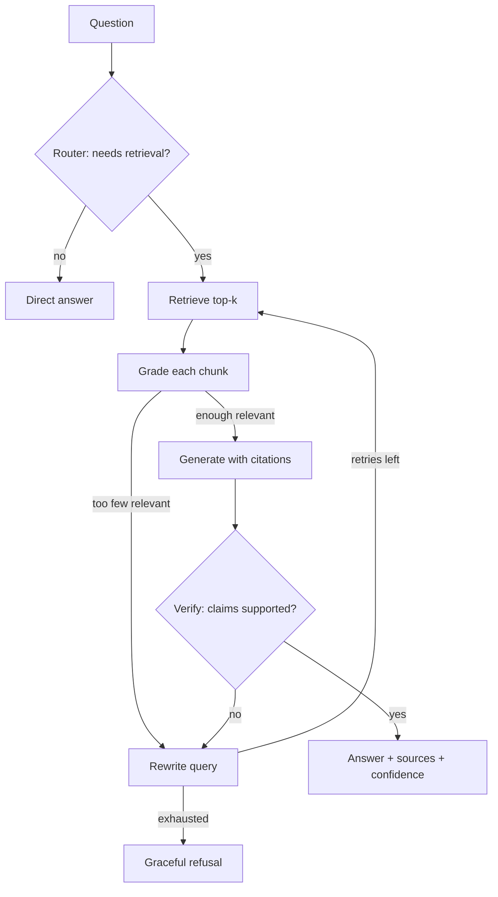

# 🔎 Self-Reflective RAG

A retrieval-augmented generation system that **checks its own work**. Instead of retrieving and answering blindly, it
decides whether to retrieve, grades every retrieved passage, verifies that its answer is supported claim-by-claim,
rewrites the query when retrieval is weak, and **refuses to answer** when the documents don't contain the answer.

> Inspired by Self-RAG (Asai et al., 2023) and Corrective RAG (Yan et al., 2024), implemented as an explicit,
> inspectable pipeline instead of fine-tuned reflection tokens.

 <!-- add your recorded GIF here -->

## Why this exists

Plain RAG fails silently: irrelevant chunks get stuffed into the prompt and the model confidently hallucinates.
This project adds four guardrails and **measures** what they buy (see [Results](#results)).

## How it works



Details: [docs/PIPELINE.md](docs/PIPELINE.md) · [docs/ARCHITECTURE.md](docs/ARCHITECTURE.md)

## Quickstart

```bash
git clone <your-repo-url> && cd self-rag
python -m venv .venv && source .venv/bin/activate     # Windows: .venv\Scripts\activate
pip install -r requirements.txt
cp .env.example .env                                   # add ANTHROPIC_API_KEY (or use Ollama)

python scripts/download_data.py --arxiv-curated --wikipedia   # ~16 papers + 15 Wikipedia pages
python -m src.ingest --reset                                  # build the vector index

streamlit run app/streamlit_app.py                     # UI with reasoning trace
uvicorn api.main:app --reload                          # REST API on :8000
```

Docker: `docker compose up --build` (API on :8000, UI on :8501).

## Example API call

```bash
curl -X POST localhost:8000/ask -H "Content-Type: application/json" \
  -d '{"question": "How does Self-RAG decide when to retrieve?", "mode": "self_rag"}'
```

Response fields: `answer`, `sources`, `confidence`, `attempts`, `refused`, `trace`, `llm_calls`, `latency_s`.

## Evaluation

```bash
python eval/generate_testset.py --n 40     # builds eval/testset.json from your corpus
python eval/run_eval.py                    # baseline vs self-reflective
```

### Results

<!-- Paste results/eval_table.md here after running. Only publish numbers you measured. -->
| Metric | Baseline RAG | Self-reflective RAG |
|---|---|---|
| correctness | _run eval_ | _run eval_ |
| faithfulness | _run eval_ | _run eval_ |
| refusal_acc | _run eval_ | _run eval_ |
| avg_llm_calls | _run eval_ | _run eval_ |

Method and caveats: [docs/EVALUATION.md](docs/EVALUATION.md)

## Project layout

```
src/        pipeline, router, grader, generator, verifier, rewriter, ingest, retriever
api/        FastAPI service          app/   Streamlit UI
eval/       test-set generation + benchmark runner
scripts/    corpus download          tests/ unit tests (fake LLM, no network)
docs/       PRD, architecture, pipeline, data, evaluation, API, setup, decisions
```

## Limitations & future work

- Reflection costs extra LLM calls and latency (quantified in the results table).
- LLM-as-judge evaluation is imperfect; use a stronger judge model and spot-check manually.
- Future: hybrid BM25 + dense search, cross-encoder reranking, streaming responses, query-log dashboard.

## License

MIT
